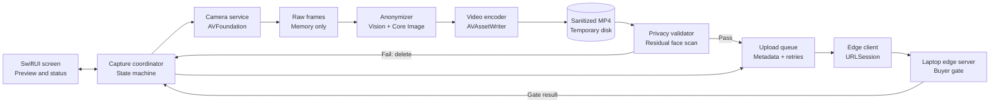

# iOS architecture

## Data boundaries

- Raw camera frames exist briefly in memory and are never uploaded or written to disk.
- Face detection and tracking run on-device before each frame reaches the encoder.
- Only the anonymized MP4 is stored temporarily on the phone.
- Finalized videos are independently sampled for residual faces before upload.
- The upload queue stores the file location, task metadata, and retry state.
- Successful uploads are deleted from the phone after the laptop confirms receipt.
- Thermal and camera-pressure signals reduce capture from 30 to 24 or 15 fps without weakening privacy.
